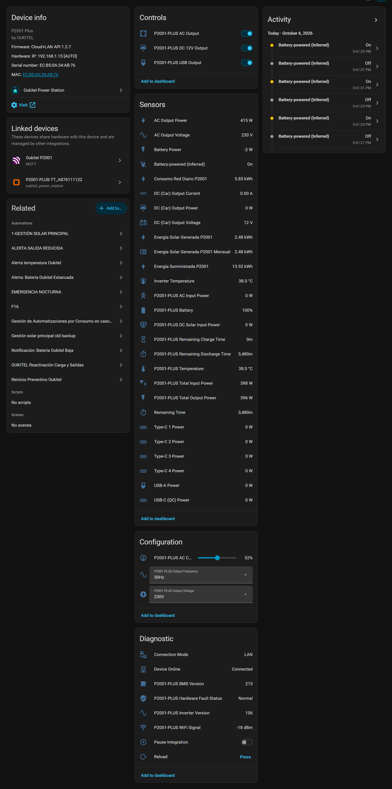
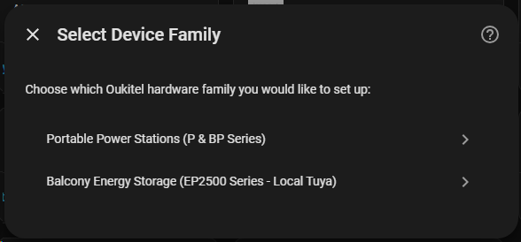
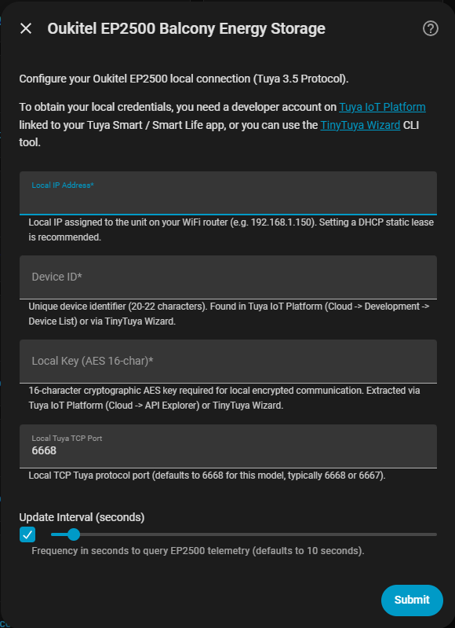

<div align="center">
  
  <h1>Oukitel Power Station Integration for Home Assistant</h1>

  [](https://github.com/hacs/default)
  [](https://www.home-assistant.io/)
  [](https://github.com/VictorCV-DAM/ha-oukitel/releases)
  [](https://github.com/VictorCV-DAM/ha-oukitel/releases)
  [](LICENSE)
  [](https://buymeacoffee.com/VictorCV)
  [](https://paypal.me/victorcava)
  [](https://ko-fi.com/victorcv)
</div>

Custom integration for Home Assistant to monitor and control **Oukitel Power Stations** (P2001 Plus, P2001, P5000, BP2000, etc.). Connects via **local LAN** when the device is on the same network, with automatic fallback to Cloud API — no phone, emulator, or ADB required.

<table width="100%">
  <tr>
    <td valign="top" width="60%">
      <b>100% VERIFIED DEVICES (Official Stable Releases):</b>
      <ul>
        <li><b>P2001E PLUS</b></li>
        <li><b>BP3000E</b></li>
        <li><b>BP2000 / BP2000 PRO</b></li>
        <li><b>P1000E PLUS</b></li>
      </ul>
      <b>🧪 BETA / COMMUNITY TESTING (<a href="https://github.com/VictorCV-DAM/ha-oukitel/tree/feature/ep2500-support"><code>feature/ep2500-support</code></a>):</b>
      <ul>
        <li><b>Oukitel EP2500</b> Balcony Solar Storage (Model <code>WXY001</code>)</li>
        <li><b>Oukitel EP2000 / B2000</b> Modular Expansion Packs</li>
        <li><b>Estimated Siblings:</b> EP3000, B3000 <i>(<a href="#-community-alpha-branch-oukitel-ep2500-balcony-energy-storage">details</a>)</i></li>
      </ul>
    </td>
    <td align="center" valign="middle" width="40%">
      <a href="#dashboard-cards--custom-lovelace-examples">
        <br/>
        <sub><i>🎨 Photorealistic OLED Lovelace Card (included)</i></sub>
      </a>
    </td>
  </tr>
</table>

---

- **Author & Maintainer:** Víctor C. V. ([@VictorCV-DAM](https://github.com/VictorCV-DAM))
- **Email:** `victorcvtrabajo@gmail.com`
- **Copyright:** © 2024-2026 Víctor C. V. All rights reserved.
- **License:** [GNU General Public License v3.0](LICENSE) (GPL-3.0).
- **Commercial Licensing:** Inquiries for enterprise or proprietary integration: `victorcvtrabajo@gmail.com`.

> [!NOTE]
> **Open Source & Dual Licensing:** This project is free and open-source software licensed under the GNU General Public License v3.0 (GPL-3.0). You are free to inspect, run, modify, and distribute it under the copyleft terms of the GPLv3. If you represent an entity seeking to embed or redistribute this software in closed-source or commercial products, contact the author for commercial licensing.

---

## ✨ Features

- **Dual Connection Mode**: Automatically connects via **local LAN** (TCP, real-time push) when the station is on the same network. Falls back to **Cloud API** (polling) if LAN is unavailable — switching is transparent and requires no user action.
- **Connection Mode Indicator**: Diagnostic entity in the device card shows whether the active connection is `LAN` or `Cloud` at all times.
- **No Phone, Emulator or ADB Required**: setup uses the cloud account once; after that, Home Assistant ↔ station traffic is local. The station itself must keep internet access to emit telemetry — see **Connection Modes** below.
- **Interactive Bidirectional Switches**: Toggle AC, DC 12V, and USB directly from Home Assistant UI and automations with optimistic latching.
- **Dynamic Energy Icons**: Automatic real-time animated battery status icons showing charging vs discharging states at 10% steps.
- **Real-Time Telemetry**: Battery %, input power (Total, AC, Solar DC), output power, temperature, estimated times, Wi-Fi signal.
- **Autonomous Keep-Alive**: Automatically prevents the power station firmware from entering sleep mode.
- **Multi-Region Support**:
  - `EU` (Europe - Verified)
  - `US` (North America - [EXPERIMENTAL])
  - `CN` (China/Asia - [EXPERIMENTAL])
- **UI Config Flow**: Native setup directly from Home Assistant Settings → Devices & Services.

---

## 📦 Quick Installation via HACS

[](https://my.home-assistant.io/redirect/hacs_repository/?owner=VictorCV-DAM&repository=ha-oukitel&category=integration)

### ⚡ 1-Click Fast Install
Click the badge above or use the direct link to open this repository inside your Home Assistant HACS store, then click **Download**.

### 🛠️ Manual HACS Installation
1. Open **HACS** in Home Assistant.
2. Click the three dots (top right corner) and select **Custom repositories**.
3. Add repository URL: `https://github.com/VictorCV-DAM/ha-oukitel` with category **Integration**.
4. Click **Download** and then **Restart Home Assistant**.
5. Go to **Settings ➔ Devices & Services ➔ Add Integration** ➔ Search for **Oukitel Power Station**.
6. Enter your account credentials (email, password, and server region `EU` / `US` / `CN`) to automatically discover your station.
7. **Perform one post-setup restart**: Quick restart via **Settings ➔ System ➔ Restart** to finalize registering all entities and Riemann energy integrators cleanly.

> [!IMPORTANT]
> **⚠️ Restart Home Assistant Once After Adding Your Device**:
> Immediately after completing the initial setup flow and adding your Oukitel Power Station:
> - **Perform a single restart of Home Assistant** (**Settings ➔ System ➔ Restart**).
> - **Why?** This ensures that Home Assistant's Entity Registry and Recorder engine cleanly initialize the linked secondary device (*Calculated Sensors*), Riemann trapezoidal energy integrators (kWh), and financial ROI metrics. Without this initial restart, calculated entities may temporarily appear as `Unavailable`.
> - **Zero subsequent restarts required**: Normal daily operation, live LAN push telemetry, tariff adjustments, and hardware control switches run 100% on-the-fly without needing any further restarts.


## 🧩 Compatibility & Certified Home Assistant Versions

To guarantee flawless operation across all 58 entities, native Riemann sum energy integrators, dynamic electricity price selectors, and bilingual tooltips, this integration certifies the following compatibility range:

| Requirement / Component | Certified Range | Notes & Verification |
|---|---|---|
| **Minimum Required Version** | **`Home Assistant 2024.1.0`** | Base requirement for modern UI Config Flow selectors, Riemann energy state restoration, and entity category metadata. |
| **Tested & Certified Range** | **`2024.1.0` — `2026.9.4+`** | Continuously tested, verified, and certified against the latest stable Home Assistant Core releases. |
| **Recommended Version** | **`2024.6.0` or newer** | Recommended to benefit from native Card Picker visual thumbnails and visual Blueprint management. |
| **Python Runtime** | **`Python 3.12+` / `3.13+`** | Fully compatible with modern Python runtimes bundled in Home Assistant Core and OS. |
| **HA Installation Types** | **HA OS, Supervised, Container, Core** | 100% compatible across all official deployment types. |

> [!TIP]
> **Hassle-Free Compatibility**: If your Home Assistant instance is running version **2024.1.0 or newer**, the integration will install cleanly with zero deprecation warnings, zero breaking changes, and without requiring manual YAML setup.

---

## 📸 Screenshots & User Interface

<div align="center">
  <h3>⚡ Full Device Dashboard & Interactive Controls</h3>
  <a href="docs/images/05_device_dashboard.png" target="_blank">
    
  </a>
  <p><i>Live telemetry: real-time battery status, bidirectional switches (AC, 12V DC, USB), input/output power, diagnostics, and frequency/voltage controls. (Click image to view in full resolution)</i></p>
</div>

<br/>

<div align="center">
  <table width="100%">
    <tr>
      <td width="50%" align="center">
        <b>1. Native Brand Search & Setup</b><br/><br/>
        <br/>
        <sub>Direct search in Home Assistant Add Integration flow.</sub>
      </td>
      <td width="50%" align="center">
        <b>2. Multi-Region Cloud Authentication</b><br/><br/>
        <br/>
        <sub>Region selection (EU/US/CN), email, password, and polling frequency.</sub>
      </td>
    </tr>
    <tr>
      <td width="50%" align="center">
        <b>3. Automatic Station Discovery</b><br/><br/>
        <br/>
        <sub>Discovers your station model, serial number, and allows naming/area assignment.</sub>
      </td>
      <td width="50%" align="center">
        <b>4. Integration Card & Connected Entities</b><br/><br/>
        <br/>
        <sub>Overview of the custom integration showing device status and 18 entities.</sub>
      </td>
    </tr>
    <tr>
      <td width="50%" align="center">
        <b>5. Device Management Hub</b><br/><br/>
        <br/>
        <sub>Hub entry point managing both the physical station and calculated metrics devices (58 entities).</sub>
      </td>
      <td width="50%" align="center">
        <b>6. Device Options, Modes & Tariffs</b><br/><br/>
        <br/>
        <sub>Configure connection modes (LAN/Cloud), local IP, telemetry frequency (3-120s), and dynamic energy tariffs (PVPC / Nord Pool).</sub>
      </td>
    </tr>
  </table>
</div>

---

## 🌐 Connection Modes: Auto, LAN & Cloud

You can configure the active connection mode at any time directly in Home Assistant (**Settings** ➔ **Devices & Services** ➔ **Oukitel Power Station** ➔ **Configure ⚙️**):

1. **Automatic (LAN preferred + Cloud)** *(Default)*: Automatically connects via local LAN (TCP port 6607, binary AES-128 push) when the station is on your home Wi-Fi network. If the station goes offline, drops Wi-Fi, or is outside the local network, it seamlessly falls back to Cloud API polling without missing data.
2. **LAN Only (Direct real-time)**: Home Assistant talks to the station locally over TCP 6607 with 0 cloud polling. HA makes no requests to the cloud; **the station still needs internet access to emit telemetry** (see the important note below).
3. **Cloud Only (Cloud / Polling)**: Standard cloud polling via the official Acceleronix/Quectel servers (ideal when Home Assistant and the power station are on separate networks or behind isolated VLANs).

> [!IMPORTANT]
> **LAN is local from Home Assistant to the station, but the station itself needs internet to emit telemetry.**
> With the WAN blocked, the `p2`–`p5` handshake completes, local writes are acknowledged and the relays still respond, but **no `cmd20` telemetry reports arrive** (`cmd17` reads go unanswered) until the station regains its vendor-cloud link. This is firmware behaviour, not an integration bug. See [docs/OFFLINE_LAN_RESEARCH.md](docs/OFFLINE_LAN_RESEARCH.md) and the note below.

| Feature | **LAN Mode** | **Cloud Mode** |
|---|---|---|
| **Protocol** | TCP port 6607 (binary, AES-128 push) | Acceleronix REST API (JSON) |
| **Latency** | Real-time push (~1 s) | Polling interval (min. 3 s) |
| **Internet Required** | Yes — the station must keep its vendor-cloud link for telemetry (HA↔station traffic stays local) | Always |
| **Switch Control Offline** | ✅ Yes (writes are acknowledged locally) | ❌ No |
| **Works Offline / Cloud Down** | ⚠️ Partial — handshake and writes work; **telemetry stops** | ❌ No |
| **Works Outside Local Network** | ❌ (requires VPN) | ✅ Yes |

> [!NOTE]
> **Comportamiento Offline y Limitación de Fabricante: "Caso de corte externo / Corte de red de proveedor"**:
> - **¿Qué es el "Caso de corte externo / Corte de red de proveedor"?**: Es el escenario real donde la vivienda o instalación pierde la conexión a internet/fibra con el operador exterior (ISP), pero el router y la Wi-Fi local siguen encendidos (típicamente alimentados por la propia estación de energía Oukitel como SAI/UPS).
> - **Control de Relés Offline**: Los interruptores de hardware (inversor AC 230V, tomas 12V DC, puertos USB) y selectores de potencia se escriben por el puerto TCP 6607 y la estación los confirma (`p6`) incluso sin conexión externa. El control local sí funciona sin WAN.
> - **Telemetría Offline: NO**: la estación necesita un enlace vivo con su nube para emitir los informes `cmd20`. Sin WAN, el handshake `p2`–`p5` termina, los writes se confirman, pero **no llega telemetría** y los `cmd17` no se responden. Al recuperar internet, el flujo se reanuda en segundos sin reconectar. Es comportamiento del firmware: la integración detecta el estancamiento y recupera la sesión, pero no puede hacer que la estación reporte sin su nube.
> - **Informe Completo y Hoja de Ruta Abierta**: Para ver el desglose técnico de códigos binarios, modelo TSL, cronogramas de prueba y posibles líneas de investigación futura para la comunidad, consulte [docs/OFFLINE_LAN_RESEARCH.md](docs/OFFLINE_LAN_RESEARCH.md).

> [!NOTE]
> **Two "starting LAN session" log lines in a row are not a bug.**
> In `auto` mode the integration makes a new LAN connection attempt when the previous socket has dropped and no listen task is active. The first line is the initial setup; the second is the `_async_update_data` retry after `_LAN_RETRY_INTERVAL` (20 s). It is a new attempt, not a duplicated log entry, and not a second simultaneous session: the `_lan_setup_in_flight` guard prevents two setups at the same time. **v1.5.8 does not label these lines yet**; the next release (1.5.9) will add `oukitel: LAN setup attempt #2 (auto_retry) — previous session inactive`. If you want to confirm it on v1.5.8, look for the previous session's disconnect before the second line.

> [!TIP]
> The **Connection Mode** diagnostic sensor on the device page always reports whether the station is actively communicating via `LAN` or `Cloud`.


---

## 🚀 What's New in v1.5.10: HACS Review Compliance & Auth Flow Hardening

- **⚙️ Asyncio import fix:** added missing `import asyncio` in `custom_components/oukitel/__init__.py` so offline boot cleanly ends in `ConfigEntryNotReady` if the station cannot be reached instead of raising a `NameError`.
- **🛡️ Authentication loop & recursion protection:** removed unbounded recursion on Cloud 5032 responses in `api.py` (`get_devices_list`, `control_device`, `get_telemetry`). When credentials fail or a password is changed, it halts cleanly after at most one retry and raises `OukitelAuthError`.
- **🔐 Reauth flow:** implemented `async_step_reauth` and `async_step_reauth_confirm` in `config_flow.py`, allowing users to enter updated credentials when password changes occur.
- **⏱️ Coordinator auth latch & backoff:** prevented `coordinator.py` from hammering the login endpoint on LAN updates after failed logins. Reconnection now triggers `async_start_reauth` on auth failure and applies exponential backoff on plain network errors.
- **📋 HACS CI validation:** removed `ignore: license` check suppression in `.github/workflows/validate.yml` to comply with default HACS catalog requirements.
- **🐍 Sensor typing import:** imported `Any` from `typing` in `sensor.py` ensuring compatibility with Python < 3.14 on Home Assistant 2024.1.0+.
- **🎨 Offline bundled frontend fonts:** replaced external Google Fonts (`fonts.googleapis.com`) in Lovelace cards with local bundled woff2 fonts (`orbitron.woff2`, `chakra-petch.woff2`, `rajdhani.woff2`) served via `/oukitel_static/fonts/` for complete offline privacy.
- **🧪 Unit test suite:** expanded unit test coverage to 32 tests covering auth failure handling, single-retry semantics, and recursion guards.

---

## 🚀 What's New in v1.5.9: Auth-Key Reliability & Multi-Station Safety

- **🔑 `authKey` refresh via `regenerateAuthKey`:** the app's own endpoint is now used to fetch the live LAN key instead of relying only on the copy frozen in `userDeviceList`. Verified on a real Home Assistant instance: stale key → `result=-1` → `regenerateAuthKey` → `data`/`options` updated → LAN reconnects. A forced 15 s timeout returns safely, without a loop or a blocked instance, and falls back to `userDeviceList`.
- **🛡️ Multi-station safety:** if the configured `device_key` is not present and the account has several stations, the integration now fails instead of silently switching to `devices[0]`. Single-station accounts still recover from a changed key; legacy entries can match by `device_name`.
- **🧾 LAN attempt logging:** `oukitel: LAN setup attempt #N (startup|resume|auto_retry)` makes retries self-explanatory.
- **📡 Documentation:** LAN control and writes work with the WAN blocked, but the station needs internet to emit telemetry. The README now says so.
- **🧪 Tests:** 25 unit tests, plus live success and timeout tests for the auth-key path.
- **📌 Issue #1:** the `battery_powered_inferred` flapping is still under investigation and is **not** fixed in this release.

---

## 🚀 What's New in v1.5.8: Resilient LAN Authentication & TTLV String Support

- **🔑 Automatic `authKey` refresh:** if the LAN login is rejected after a factory reset or rebind, the integration fetches the new `authKey` from the cloud, updates the config entry (`data` and `options`) and retries once. Verified on a real Home Assistant instance: stale key → `result=-1` → refresh → reconnect.
- **🔤 TTLV string support:** `ttlv_encode` now supports type 3 UTF-8 strings, and `ttlv_decode` decodes type 3 as UTF-8 (type 5 behaviour unchanged). Round-trip tests included.
- **🧪 Tests:** 17 unit tests covering TTLV strings and the `authKey` refresh decision logic.
- **📌 Scope:** BLE provisioning and the optional MCC field remain in `feature/zero-cloud-broker`; this release only changes the LAN/auth path.

---

## 🚀 What's New in v1.5.7: Official Quectel Heartbeat, Offline LAN Control & Firmware Resilience

- **💓 Official Quectel LAN Heartbeat (`CMD 28727 <-> 28728`):** Implemented the authentic Quectel binary heartbeat discovered through bytecode reverse engineering. The station acknowledges every ping immediately, preventing TCP socket teardowns on silence.
- **⚡ Native High-Frequency LAN Reporting (`Tag 100 = 1`):** Subscribes directly using the official manufacturer TSL specification (`high_frequency_reporting: 1 = 局域网高频上报`), eliminating redundant dual-mode packet hammering.
- **🔌 100% Offline Switch Control:** AC, DC, and USB power relays execute instantly via local LAN with millimeter precision, even during total internet/fiber outages.
- **🛡️ Watchdog & Resilience Hardening:** Removed aggressive 45-second silence disconnects in `coordinator.py`. Entities remain permanently `Available` in Home Assistant without false "Unavailable" drops or reload hangs.
- **🔄 Instant 30-Second Auto-Recovery:** When internet or Wi-Fi reconnects after an outage, the real-time telemetry stream auto-recovers completely autonomously within 30 seconds without requiring Home Assistant or integration restarts.
- **🧹 Zero Log Pollution:** Relegated all routine high-frequency incoming telemetry and write ACK frames from `INFO` to `DEBUG`, keeping user logs clean and performant.
- **🔬 Comprehensive Research Log:** Added [docs/OFFLINE_LAN_RESEARCH.md](docs/OFFLINE_LAN_RESEARCH.md) detailing the reverse-engineered packet structure, empirical timing tests, hardware limitations of the Quectel Wi-Fi MCU, and open research avenues for the developer community.

---

## 🚀 What's New in v1.5.6: Startup LAN Race Elimination, Multi-Protocol Struct Switches & Hardware Resilience

- **🔒 Startup LAN Race Condition Elimination:** Implemented strict exclusion locks (`_lan_setup_in_flight`), monotonic retry cooldowns, and instance identity checks in `local_session.py` to prevent duplicate concurrent TCP connections on port 6607 during HA startup.
- **⚡ Multi-Protocol Acceleronix Cloud Struct Switches:** Fixed switch write payload serialization for BP-series hardware (`BP2000`, `BP3000`), formatting parameters as `[{prop: {key: value}}]` instead of flat strings, permanently resolving switch bouncing.
- **🔌 Standby AC Output Voltage Zeroing:** AC output voltage reading cleanly drops to `0 V` when the AC inverter is switched off and output wattage is `0 W`, preventing phantom voltage readings in Home Assistant dashboards.
- **🔁 Resilient Switch Retry Mechanism:** Added automatic 1.5s retry in `async_send_switch_command` to transparently absorb socket recycling transitions or cloud 5340 transient dropouts.
- **🧹 Cleaned Heartbeat Logging:** Demoted routine 12-second LAN keepalive notifications from `INFO` to `DEBUG` to keep Home Assistant production logs clean and concise.
- **⚡ Hybrid LAN + Cloud Shadow Dynamic Sync:** Real-time push for all active power meters (W), switches, and battery SoC via local TCP socket (6607), combined with continuous background shadow synchronization for temperature, Wi-Fi signal, and firmware metadata.
- **🔄 Instant Connection Reload Button:** Interactive **Reload Connection** entity (`button.oukitel_reload_connection`) for immediate session re-establishment across connection modes.
- **🌐 100% Bilingual Localization (English & Spanish):** Full translations across all 58 entities, options flows, device descriptions, and Lovelace visual cards.
- **🛡️ Documented P2001E Plus Hardware Safety Interlock:** Detailed physical isolation protocols (DC breaker & 2P AC breaker) when reactivating the AC inverter during simultaneous solar/grid charging.

---

## 🚀 Advanced Energy Architecture & Calculated Metrics (v1.5.0+)
*(Development Roadmap: Milestones & Integrated Capabilities)*

Version **1.5.0** marks a monumental milestone in the integration's evolution. Transitioning from basic telemetry into a full-scale Home Assistant Energy & Financial Management ecosystem, the integration now automatically discovers **2 connected devices** and exposes **58 native entities**:

<div align="center">
  <table width="100%">
    <tr>
      <td width="50%" align="center">
        <b>1. Dual Connected Devices (36 + 22 = 58 Entities)</b><br/><br/>
        <br/>
        <sub>Clean separation between the physical Power Station and the child Calculated Metrics device.</sub>
      </td>
      <td width="50%" align="center">
        <b>2. Calculated Sensors Device (22 Specialized Entities)</b><br/><br/>
        <br/>
        <sub>Riemann Energy kWh, daily/monthly/lifetime financial ROI (€), battery health, and predictive timestamps.</sub>
      </td>
    </tr>
  </table>
</div>

### 🌟 Key Milestones & Capabilities Implemented:

#### 1. ⚡ Native Home Assistant Energy Dashboard Compatibility (kWh)
Eliminates the need for manual Riemann sum integration helpers. Energy is integrated continuously via trapezoidal rule with state restoration (`RestoreEntity`), making your Oukitel station instantly selectable in Home Assistant's official **Energy Dashboard**:
- **`sensor.oukitel_ac_input_kwh`**: Cumulative energy imported from the AC grid for charging.
- **`sensor.oukitel_dc_solar_input_kwh`**: Cumulative solar energy generated by photovoltaic panels.
- **`sensor.oukitel_total_output_kwh`**: Total cumulative energy delivered to all connected loads (AC + DC + USB).
- **`sensor.oukitel_ac_output_kwh`**: Total energy consumed through the 230V AC output sockets.
- **`sensor.oukitel_battery_discharged_kwh`**: Total energy extracted directly from the battery cells.
- **`sensor.oukitel_daily_ac_input_kwh`**: Daily AC grid energy imported, resetting automatically at midnight.

#### 2. 💶 Real-Time Financial Balance & Solar ROI (€ / Configurable Currency)
Enables tracking of exact economic cost and solar self-consumption savings in real time:
- **Dynamic Tariff Support**: Automatically syncs with your electricity price sensor (e.g. PVPC in Spain, Nord Pool) or uses a fixed price fallback (default: `0.15 €/kWh`).
- **`sensor.oukitel_daily_charging_cost`**: Economic cost of grid charging today.
- **`sensor.oukitel_monthly_charging_cost`**: Monthly electrical grid charging cost.
- **`sensor.oukitel_daily_solar_savings`**: Daily economic savings generated by solar photovoltaic self-consumption.
- **`sensor.oukitel_monthly_solar_savings`**: Accumulated monthly savings generated by solar harvesting.
- **`sensor.oukitel_daily_net_savings`**: Daily net financial balance (`Solar Savings` minus `Grid Charging Cost`).
- **`sensor.oukitel_lifetime_savings`**: Historical lifetime savings generated since installation.
- **`sensor.oukitel_lifetime_charging_cost`**: Historical lifetime cost of grid charging.

<div align="center">
  
  <p><i>Configure connection mode, dynamic price sensor (PVPC / Nord Pool), currency symbol, and fallback tariff directly in device options.</i></p>
</div>

#### 3. ⏱️ Predictive Autonomy Engine ("Exact Clock Shutdown & Full Charge Time")
Solves the issue of erratic remaining-time fluctuations caused by transient high-power appliance surges (e.g. coffee maker or microwave):
- **15-Minute Moving Average Filter**: Smooths net discharge loads over time while instantly adapting to operational mode transitions (discharging vs charging).
- **`sensor.oukitel_predicted_empty_time`** (`empty_timestamp`): Native timestamp entity (`SensorDeviceClass.TIMESTAMP`) showing the exact clock time when the battery will reach 0% (e.g. *"In 5 hours"* or *"Today at 19:42"*). Ideal for automations and mobile push notifications.
- **`sensor.oukitel_predicted_full_charge_time`** (`full_charge_timestamp`): Native timestamp entity predicting the exact clock time the battery will reach 100% full charge.
- **`sensor.oukitel_smoothed_discharge_time`**: Autonomy in minutes (`duration`), perfectly suited for steady historical graphs without spike artifacts.

#### 4. 🩺 Battery Health & Degradation Tracker
Proactively monitors cell aging and BMS calibration:
- **`sensor.oukitel_battery_cycles_count`**: Cumulative equivalent full charge/discharge cycles based on the **IEC 62620** standard (total discharged energy divided by rated model capacity, e.g. 2,048 Wh for P2001 Plus, 5,120 Wh for P5000).
- **`sensor.oukitel_battery_state_of_health_estimated`**: Estimated State of Health (SoH %) modeled for premium EV-grade LiFePO4 chemistry (rated at 3,500 cycles to 80% capacity).
- **`sensor.oukitel_days_since_last_full_charge`**: Days elapsed since the last 100% charge. Alerts the user when top-balancing cell calibration is advised (>30 days).

#### 5. 📊 Inverter Efficiency & Sandia Quadratic Loss Modeling
Features calibrated mathematical modeling of the bidirectional pure sine wave inverter:
- **`sensor.oukitel_inverter_idle_power`**: Parasitic tare consumption of the active AC inverter with no load (18.0 W when AC is on, 0 W when off).
- **`sensor.oukitel_inverter_efficiency`**: Real-time conversion efficiency percentage (up to 98.5% in bypass passthrough; 92.3%–92.5% peak inversion curve).
- **`sensor.oukitel_inverter_loss_power`**: Internal thermal dissipation and conversion losses in Watts.

#### 6. 🌐 100% Bilingual Ecosystem (Spanish & English)
All 58 entities now dynamically detect the configured Home Assistant language (`hass.config.language`). When hovering over any entity in standard Lovelace views, tooltips and `attributes.description` adapt automatically to clean Spanish or English.

#### 7. 📦 Official Embedded Automation Blueprint ("Smart Energy Shifting")
Includes a preconfigured official automation blueprint ready to import into Home Assistant with one click:
- **`Oukitel Solar & Battery Manager (Smart Energy Shifting)`** (`blueprints/automation/oukitel/solar_battery_manager.yaml`): Automates overnight valley-hour grid charging and daytime peak-hour battery discharge with customizable reserve thresholds.

<div align="center">
  <table width="100%">
    <tr>
      <td width="42%" align="center">
        <b>1. Discovered Blueprint in Home Assistant</b><br/><br/>
        <br/>
        <sub>Single-click automation creation from the Blueprints panel.</sub>
      </td>
      <td width="58%" align="center">
        <b>2. Visual Configuration & Smart Rules</b><br/><br/>
        <br/>
        <sub>Configurable critical reserve %, sunrise solar priority, 50% solar ceiling, and monthly BMS balance day.</sub>
      </td>
    </tr>
  </table>
</div>

---

## 📊 Entities Provided

The integration automatically exposes **58 entities** organized across **2 linked devices**:
- **Device 1: Primary Power Station (`36 entities`)**: Live telemetry, per-port outputs, bidirectional switches, and hardware controls.
- **Device 2: Calculated Energy & Financial Metrics (`22 entities`)**: Energy kWh accumulators, financial ROI metrics, battery health, and predictive timestamps.

> [!NOTE]
> **Entities Enabled vs. Disabled by Default**:
> Out of the 58 total entities exposed by the integration, **49 entities are enabled by default** for immediate plug-and-play monitoring. To prevent dashboard clutter, **9 secondary entities are disabled by default** in Home Assistant's entity registry:
> - **`sensor.oukitel_remaining_time`**: Generic display countdown (disabled in favor of the dedicated, direction-aware `remaining_discharge_time` and `remaining_charge_time`).
> - **Per-port USB wattage breakdown**: `usb_a_power`, `usb_c_qc_power`, `typec1_power`, `typec2_power`, `typec3_power`, `typec4_power`.
> - **Secondary 12V DC metrics**: `dc_output_voltage` and `dc_output_current` (the main `dc_output_power` is enabled by default).
> 
> *You can enable any of these secondary sensors at any time in Home Assistant under **Settings ➔ Devices & Services ➔ Oukitel Power Station ➔ Entities**, selecting the disabled sensor and clicking **Enable entity**.*

### 🔋 Core Telemetry & Energy
- `sensor.oukitel_battery`: Battery level (%) with dynamic real-time charging/discharging animated icons.
- `sensor.oukitel_total_input_power`: Total aggregate incoming power from AC grid and solar DC (W).
- `sensor.oukitel_total_output_power`: Total aggregate power consumed across all active outlets (W).
- `sensor.oukitel_ac_input_power`: AC grid wall charging power (W).
- `sensor.oukitel_dc_solar_input_power`: Solar array photovoltaic input power (W).
- `sensor.oukitel_temperature`: Internal heatsink & cell temperature (°C).
- `sensor.oukitel_inverter_temperature`: Inverter thermal monitoring with automatic sensor fallback (°C).

### ⏱️ Smart Physics-Based Autonomy & Remaining Times
Unlike native station firmware which can confuse charging and discharging when solar production is lower than household consumption, this integration implements a **real-time net power balance engine**:
- `sensor.oukitel_remaining_time`: Station LCD display equivalent time (minutes) *(Disabled by default in favor of separate charge/discharge sensors)*.
- `sensor.oukitel_remaining_discharge_time`: True battery autonomy countdown while net discharging (minutes). Automatically sets to `0` when net charging.
- `sensor.oukitel_remaining_charge_time`: Intelligent estimate to reach 100% full capacity while net charging (minutes). Automatically sets to `0` when net discharging or already at 100%. Bypasses the station's 99-hour (5,940m) display overflow cap with dynamic calculations.

### 🔌 Per-Port Individual Telemetry
- `sensor.oukitel_ac_output_power`: 230V Pure Sine Wave inverter output (W).
- `sensor.oukitel_ac_output_voltage`: Real-time inverter output voltage (V). Accurately reports active voltage (e.g. 230V) when inverted output is active, and 0V when off.
- `sensor.oukitel_type_c_1_power`: Fast-charge Type-C 1 port power (W) *(Disabled by default)*.
- `sensor.oukitel_type_c_2_power`: Type-C 2 port power (W) *(Disabled by default)*.
- `sensor.oukitel_type_c_3_power`: Type-C 3 port power (W) *(Disabled by default)*.
- `sensor.oukitel_type_c_4_power`: Type-C 4 port power (W) *(Disabled by default)*.
- `sensor.oukitel_usb_a_power`: Standard USB-A port power (W) *(Disabled by default)*.
- `sensor.oukitel_usb_c_qc_power`: Quick Charge USB-C port power (W) *(Disabled by default)*.
- `sensor.oukitel_dc_car_output_power`: 12V DC cigarette lighter socket power (W).
- `sensor.oukitel_dc_car_output_voltage`: 12V DC car socket voltage (V) *(Disabled by default)*.
- `sensor.oukitel_dc_car_output_current`: 12V DC car socket current (A) *(Disabled by default)*.

*(Note: All port power sensors default to `0 W` immediately upon startup, guaranteeing zero `Unknown` states even before individual sub-packets arrive).*

### 📊 Inverter Efficiency & Internal Loss Sensors
- `sensor.oukitel_inverter_idle_power`: Standby / tare no-load power consumed by the pure sine wave inverter board (W). Accurately reports 18.0 W when AC switch is active without load, and 0 W when turned off.
- `sensor.oukitel_inverter_efficiency`: Real-time power conversion efficiency (%). Features calibrated Sandia quadratic inverter loss modeling for Oukitel bidirectional inverters (up to 98.5% in UPS bypass passthrough; 92.5% peak inverting curve).
- `sensor.oukitel_inverter_loss_power`: Real-time internal thermal dissipation and conversion losses in Watts (W).

### 🩺 Battery Health & Degradation Tracker
- `sensor.oukitel_battery_cycles_count`: Cumulative full equivalent charge/discharge cycles (IEC 62620 standard) calculated by tracking total energy throughput against rated capacity (e.g. 2,048 Wh for P2001 Plus, 5,120 Wh for P5000).
- `sensor.oukitel_battery_state_of_health_estimated`: Estimated State of Health (SoH %) based on the LiFePO4 cell degradation curve (3,500 cycles to 80% capacity).
- `sensor.oukitel_days_since_last_full_charge`: Elapsed days since the last 100% charge. Alerts when top-balancing calibration is recommended (>30 days).

### 💡 Universal Tooltips & Functional Descriptions on Hover
Every entity created by the integration includes an informative, functional description in Spanish (`attributes.description`). When hovering the mouse cursor over any sensor or entity in Home Assistant's Lovelace cards (standard Entities card, Tile cards, or custom cards), a native tooltip pops up explaining exactly what the sensor measures and its function, instead of just repeating its name.

### 🛡️ Diagnostic & Health Sensors
- `sensor.oukitel_hardware_fault_status`: **Official Home Assistant ENUM sensor** with predefined, standardized states for direct use in automations.
- `sensor.oukitel_connection_mode`: Active transport layer (`LAN` or `Cloud`) · *Diagnostic*.
- `sensor.oukitel_wifi_signal`: Cloud Wi-Fi RSSI (dBm) · *Diagnostic*.
- `sensor.oukitel_bms_version`: BMS firmware version · *Diagnostic*.
- `sensor.oukitel_inverter_version`: Inverter firmware version · *Diagnostic*.

### 🔌 Binary Sensors & Quick Actions
- `binary_sensor.oukitel_device_online`: Real-time connectivity sensor (`Connectivity` diagnostic class). Reports whether the power station is online and actively communicating via LAN socket or Cloud gateway. Automatically zeros out active wattages when offline to prevent stale ghost telemetry while preserving SoC and temperatures.
- `binary_sensor.oukitel_battery_powered_inferred`: Detects whether the station is actively running on battery (net discharging or mains/solar input absent).
- `button.oukitel_reload`: Instantly reloads the integration session without restarting Home Assistant.

### 🎛️ Bidirectional Switches & Settings
- `switch.oukitel_ac_output`: Toggle 230V AC inverter output with optimistic latching.
- `switch.oukitel_dc_12v_output`: Toggle 12V DC car/barrel port output.
- `switch.oukitel_usb_output`: Toggle USB & Type-C power bank outputs.
- `switch.oukitel_pause_integration`: Master toggle to pause all polling, disconnect the LAN socket, and stop keep-alive/wake commands. Allows the station to enter deep sleep without Home Assistant waking it up. Fully actionable via automations (`switch.turn_on` / `switch.turn_off`).
- `number.oukitel_ac_charging_limit`: AC Upper Limit Charging Power slider (3% to 100%).
- `select.oukitel_output_frequency`: Output Frequency setting (`50Hz` / `60Hz`).
- `select.oukitel_output_voltage`: Output Voltage setting (`200V`, `208V`, `220V`, `230V`, `240V`).

> [!WARNING]
> ### ⚠️ Hardware Safety Interlock (P2001E Plus): AC Switch Reactivation during Active Charging
> In the **P2001E Plus** (and related firmware architectures), disconnecting the AC inverter output while the battery is actively receiving power (**Solar Photovoltaic DC** or **Grid AC charging**) engages an internal hardware safety interlock that **blocks the AC output switch from turning back on**.
> 
> - **Why?** The station's BMS/inverter hardware is designed for safety and inhibits inverter re-arming while active charging input voltage is detected at its ports.
> - **Why standard smart plugs fail:** A common single-pole smart plug (*enchufe inteligente unipolar*) is **not** sufficient for grid AC charging. Because unipolar switches only open one line (phase), stray voltage or ground/neutral continuity prevents the station from sensing a full disconnection, keeping the AC switch locked.
> - **Recommended Solution for Automations:**
>   1. **DC Solar Input:** Install a dedicated **DC DIN-rail circuit breaker** (*magnetotérmico DC*) to cut photovoltaic input when automation requires resetting the inverter.
>   2. **Grid AC Input:** Use a **true bipolar disconnect** (*corte bipolar* via 2P DIN-rail breaker or dual-pole smart relay/contactor) on the AC charging line.
>   3. Once input power is cleanly isolated, the AC output switch re-engages immediately and flawlessly from Home Assistant.

### ⚡ Calculated Energy & Financial Entities (Device 2: Calculated Sensors)
All 22 entities in this group belong to the linked child device `[Station Name] Calculated Sensors`:
- `sensor.oukitel_ac_input_kwh`: AC Grid cumulative charging energy (kWh).
- `sensor.oukitel_dc_input_kwh`: Photovoltaic solar generation energy (kWh).
- `sensor.oukitel_total_output_kwh`: Total station cumulative energy delivered (kWh).
- `sensor.oukitel_ac_output_kwh`: 230V AC socket cumulative energy (kWh).
- `sensor.oukitel_battery_discharged_kwh`: Cumulative energy extracted from battery cells (kWh).
- `sensor.oukitel_daily_ac_input_kwh`: Daily AC grid charging energy with midnight reset (kWh).
- `sensor.oukitel_daily_charging_cost`: Daily grid charging cost (€ / currency).
- `sensor.oukitel_monthly_charging_cost`: Monthly grid charging cost (€ / currency).
- `sensor.oukitel_daily_solar_savings`: Daily solar self-consumption savings (€ / currency).
- `sensor.oukitel_monthly_solar_savings`: Monthly solar savings (€ / currency).
- `sensor.oukitel_daily_net_savings`: Daily net financial balance (€ / currency).
- `sensor.oukitel_lifetime_savings`: Cumulative lifetime solar savings (€ / currency).
- `sensor.oukitel_lifetime_charging_cost`: Cumulative lifetime charging cost (€ / currency).
- `sensor.oukitel_predicted_empty_time`: Estimated battery 0% shutdown timestamp (`SensorDeviceClass.TIMESTAMP`, key: `empty_timestamp`).
- `sensor.oukitel_predicted_full_charge_time`: Estimated 100% full charge timestamp (`SensorDeviceClass.TIMESTAMP`, key: `full_charge_timestamp`).
- `sensor.oukitel_smoothed_discharge_time`: 15-minute moving average smoothed autonomy (minutes).
- `sensor.oukitel_inverter_idle_power`: Standby tare power (18.0 W when on, 0 W off).
- `sensor.oukitel_inverter_efficiency`: Conversion efficiency (%).
- `sensor.oukitel_inverter_loss_power`: Internal thermal dissipation (W).
- `sensor.oukitel_battery_cycles_count`: Equivalent full charge/discharge cycles (IEC 62620).
- `sensor.oukitel_battery_state_of_health_estimated`: Estimated State of Health (SoH %).
- `sensor.oukitel_days_since_last_full_charge`: Elapsed days since last 100% top-balance charge.

---

## 🛡️ Hardware Fault Status & Native Automations

The `sensor.oukitel_hardware_fault_status` entity is implemented as a native **Home Assistant Enum Sensor** (`SensorDeviceClass.ENUM`). This means you do **not** have to guess what strings might occur: when configuring triggers in the Home Assistant Automation UI, all valid states appear directly in the dropdown menu:

| State in Dropdown | Trigger Condition | Recommended Automation Action |
|:---|:---|:---|
| **`Normal`** | System operating within all safety specifications. | Resume normal schedule / clear alert dashboard. |
| **`High Temperature Warning`** | Internal heatsink/battery temperature $\ge 55^\circ\text{C}$. | Trigger cooling fan or reduce AC charging rate. |
| **`Over-Temperature`** | Internal temperature exceeds critical limit $\ge 65^\circ\text{C}$. | Disconnect heavy loads or shut down AC inverter. |
| **`Under-Temperature`** | Temperature falls below $-10^\circ\text{C}$ (LiFePO4 charge lock). | Inhibit high-current charging until warm. |
| **`Low Battery Warning`** | Battery $\le 10\%$ while actively discharging. | Send mobile push notification, shed secondary loads. |
| **`Critical Low Battery`** | Battery reaches $0\%$ under load. | Emergency shutdown to protect battery cells. |
| **`Overload Protection`** | Total output exceeds rated continuous capacity (e.g. $> 4,000\,\text{W}$ for P5000, $> 3,600\,\text{W}$ for BP3000, $> 2,400\,\text{W}$ for P2001 Plus, $> 2,200\,\text{W}$ for BP2000, $> 1,800\,\text{W}$ for P1000). | Automatically trip or notify before hardware breaker trips. |
| **`Hardware Fault`** | Critical BMS or inverter hardware error code emitted. | Emit priority siren / emergency notification. |

### Entity Attributes (`extra_state_attributes`)
- `fault_details`: Human-readable description of the exact trigger (e.g. *"Output power (2650W) exceeds rated 2400W"* dynamically adapting to the station model, or *"Temperature is critical: 67°C"*).
- `possible_states`: Complete array of all possible enum states.

### Example Automation: High Temperature Alert
```yaml
alias: "Oukitel: Thermal Protection Alert"
description: "Notify and turn off heavy loads if Oukitel station overheats"
trigger:
  - platform: state
    entity_id: sensor.p2001_plus_tt_ab76_hardware_fault_status
    to:
      - "High Temperature Warning"
      - "Over-Temperature"
action:
  - service: notify.persistent_notification
    data:
      title: "⚠️ Oukitel Thermal Warning"
      message: >-
        Station reported {{ trigger.to_state.state }}.
        Details: {{ state_attr(trigger.entity_id, 'fault_details') }}.
```

---

## 🔬 Reverse-Engineering & Architecture Methodology

How was this information discovered and implemented?

1. **Thing Specification Language (TSL) Reverse Engineering:**
   The exact data model for the P2001 Plus was extracted by querying the Quectel / Acceleronix IoT Cloud device model repository for `productKey: p11wN7`. This revealed all 21 official properties, including the complex structs:
   - Tag 6 (`ac_data`): subtag 1 (`ac_switch`), subtag 2 (`ac1_output`), subtag 3 (`ac1_output_voltage`).
   - Tag 7 (`usb_data`): subtag 1 (`usb_switch`), subtag 2 (`USB_QC1_output`), subtag 3 (`USB_QC2_output`).
   - Tag 8 (`typec_data`): subtags 2, 5, 6, 7 (dedicated wattage for Type-C ports 1 through 4).
   - Tag 9 (`dc_data`): subtag 1 (`dc_switch`), subtag 2 (`car1_output`), subtag 3 (`car1_output_voltage`), subtag 4 (`car1_output_current`).
   - Tag 28 (`ACvoltage_Switchover`): Enums for 100V, 110V, 120V, 220V, and 230V.

2. **Binary LAN Protocol (Port 6607):**
   The station exposes an unadvertised local TCP service on port 6607 using a custom framing protocol (SLIP-like destuffing with `0xEB 0x90` frame magic and XOR byte-stuffing). The payload is encrypted with AES-128-CBC using a device-specific `authKey` provisioned over Cloud binding, and the decrypted body uses a compact TTLV (Tag-Type-Length-Value) encoding. Our parser decodes both scalar tags and nested struct subtags in real time.

3. **Physics & Battery Management Engine:**
   Official station firmware has known display quirks:
   - When solar input is present (e.g. 337W) but household AC draw is larger (e.g. 342W), the firmware's internal flag often incorrectly treats the battery as charging. We solved this with a pure physics engine:
     $$\text{NetPower} = \max(\text{Total}_{\text{in}}, \text{AC}_{\text{in}} + \text{DC}_{\text{in}}) - \max(\text{Total}_{\text{out}}, \text{AC}_{\text{out}} + \text{DC}_{\text{out}})$$
   - When charging at low net wattage, the firmware's internal integer overflows its 99-hour display limit, getting stuck at 5,940 minutes (99 hours). We dynamically calculate real remaining time based on each model's nominal battery capacity (e.g. 5,120 Wh for P5000, 3,072 Wh for BP3000, 2,048 Wh for P2001/BP2000, 1,024 Wh for P1000).

4. **Home Assistant Native Standards:**
   Rather than treating fault alarms as arbitrary text, we mapped all physical and firmware thresholds to standard Home Assistant `SensorDeviceClass.ENUM` contracts so the HA UI natively presents all actionable choices directly to the user.

---

<a id="dashboard-cards--custom-lovelace-examples"></a>
## 🎨 Dashboard Cards & Custom Lovelace Examples

### 🌟 Official Plug & Play Cards (`custom:oukitel-card` & `custom:oukitel-display-card`)

The integration automatically registers two custom Lovelace cards in your Home Assistant resources. When adding a card in your dashboard, simply search for **`ouki`** in the native Card Picker:

<div align="center">
  <table width="100%">
    <tr>
      <td width="50%" align="center">
        <b>1. Native Home Assistant Card Picker</b><br/><br/>
        <br/>
        <sub>Visual selection with live preview thumbnails for both the Control Card and LCD Display Card.</sub>
      </td>
      <td width="50%" align="center">
        <b>2. Full Interactive Control Station Card</b><br/><br/>
        <br/>
        <sub>Photorealistic LCD screen, 2-step safety switch toggles, and daily financial ROI balance.</sub>
      </td>
    </tr>
  </table>
</div>

#### Ready-to-use Lovelace YAML:
```yaml
type: custom:oukitel-card
```
*(Zero manual configuration required: it automatically auto-discovers your Oukitel station entities!)*

---

### Alternative Custom Lovelace Configurations (Manual Cards)

Here are curated manual Lovelace card examples to monitor your Oukitel Power Station with custom visuals:

### 1. Animated Battery Graphic (Picture Elements)

Displays the station's animated battery graphic with live percentage overlaid in the center:


```yaml
type: picture-elements
image: /local/oukitel/icon.svg
elements:
  - type: state-label
    entity: sensor.p2001_plus_tt_ab76_p2001_plus_battery
    tap_action:
      action: more-info
    style:
      top: 75%
      left: 50%
      transform: translate(-50%, -50%)
      color: white
      font-size: 24px
      font-weight: bold
      text-shadow: 2px 2px 4px rgba(0,0,0,0.8)
```
*(Note: Replace `sensor.p2001_plus_tt_ab76_p2001_plus_battery` with your device's entity ID).*

---

### 2. Header & Battery Autonomy Ring (custom:button-card)

Top header bar and circular gauge showing battery level, remaining autonomy, solar input, and AC load:


```yaml
type: vertical-stack
cards:
  - type: custom:button-card
    name: OUKITEL P2001
    show_name: true
    show_state: false
    styles:
      card:
        - background: '#1a1a1a'
        - border-radius: 30px 30px 0px 0px
        - padding: 20px 10px 5px 10px
        - border: none
        - margin-bottom: -8px
      name:
        - font-size: 22px
        - font-weight: bold
        - color: rgba(255, 255, 255, 0.9)
        - text-transform: uppercase
        - letter-spacing: 1px
  - type: custom:button-card
    entity: sensor.p2001_plus_tt_ab76_p2001_plus_battery
    aspect_ratio: 1/1
    show_name: false
    show_state: false
    custom_fields:
      ring: |
        [[[
          const pct = parseFloat(states['sensor.p2001_plus_tt_ab76_p2001_plus_battery']?.state || 0);
          const entrada = parseFloat(states['sensor.p2001_plus_tt_ab76_p2001_plus_total_input_power']?.state || 0);
          const consumo = parseFloat(states['sensor.p2001_plus_tt_ab76_p2001_plus_total_output_power']?.state || 0);
          const modo = entrada > (consumo + 5) ? 'carga' : (consumo > (entrada + 5) ? 'descarga' : 'reposo');
          const color = modo === 'carga' ? '#00d2ff' : (modo === 'descarga' ? '#f5576c' : '#2ecc71');
          
          /* Ajustes de grosor y radio */
          const radius = 42; 
          const circ = 2 * Math.PI * radius;
          const offset = circ * (1 - pct / 100);
          
          /* Lógica para 10 segmentos */
          const numSegmentos = 10;
          const gap = 3; 
          const segmentLength = (circ / numSegmentos) - gap;
          const divisiones = `${gap} ${segmentLength}`; 

          return `
            <svg viewBox="0 0 100 100">
              <circle cx="50" cy="50" r="${radius}" fill="none" 
                stroke="rgba(255,255,255,0.05)" stroke-width="12" />
              
              <circle cx="50" cy="50" r="${radius}" fill="none" stroke="${color}" stroke-width="12" 
                stroke-dasharray="${circ}" 
                stroke-dashoffset="${offset}" 
                stroke-linecap="butt" transform="rotate(-90 50 50)" style="transition: all 1s ease-out;" />
                
              <circle cx="50" cy="50" r="${radius}" fill="none" stroke="#1a1a1a" stroke-width="14" 
                stroke-dasharray="${divisiones}" transform="rotate(-91.5 50 50)" />

              <text x="50" y="48" text-anchor="middle" font-size="6" fill="rgba(255,255,255,0.5)" font-weight="bold">BATERÍA</text>
              <text x="50" y="62" text-anchor="middle" font-size="14" fill="white" font-weight="bold">${Math.round(pct)}%</text>
            </svg>
          `;
        ]]]
      tiempo: |
        [[[
          const entrada = parseFloat(states['sensor.p2001_plus_tt_ab76_p2001_plus_total_input_power']?.state || 0);
          const consumo = parseFloat(states['sensor.p2001_plus_tt_ab76_p2001_plus_total_output_power']?.state || 0);
          const modo = entrada > (consumo + 5) ? 'carga' : (consumo > (entrada + 5) ? 'descarga' : 'reposo');
          const label = modo === 'carga' ? 'CARGA COMPLETA EN:' : (modo === 'descarga' ? 'AUTONOMÍA' : 'EN ESPERA');
          let mins = 0;
          if (modo === 'carga') {
            mins = parseInt(states['sensor.p2001_plus_tt_ab76_p2001_plus_remaining_charge_time']?.state || 0);
          } else if (modo === 'descarga') {
            mins = parseInt(states['sensor.p2001_plus_tt_ab76_p2001_plus_remaining_discharge_time']?.state || 0);
          }
          const h = Math.floor(mins / 60);
          const m = mins % 60;
          const formatted = (mins <= 0 || mins >= 5940) ? '--' : `${h}h ${m < 10 ? '0' : ''}${m}m`;
          return `
            <div style="text-align: center;">
              <div style="font-size: 10px; opacity: 0.6; font-weight: bold;">${label}</div>
              <div style="font-size: 24px; font-weight: 900; color: white; line-height: 1.1;">${formatted}</div>
            </div>
          `;
        ]]]
      watts: |
        [[[
          const entrada = states['sensor.p2001_plus_tt_ab76_p2001_plus_total_input_power'].state;
          const consumo = states['sensor.p2001_plus_tt_ab76_p2001_plus_total_output_power'].state;
          return `
            <div style="display: flex; justify-content: space-around; width: 100%; font-size: 14px; font-weight: bold;">
              <span style="color: #4caf50;">↑ ${entrada}W</span>
              <span style="color: #f44336;">↓ ${consumo}W</span>
            </div>
          `;
        ]]]
    styles:
      card:
        - border-radius: 0px 0px 30px 30px
        - background: '#1a1a1a'
        - padding: 10%
        - border: none
      grid:
        - grid-template-areas: '"ring" "tiempo" "watts"'
        - grid-template-columns: 1fr
        - grid-template-rows: 1fr auto auto
      custom_fields:
        ring:
          - width: 85%
          - justify-self: center
        tiempo:
          - margin-top: 30px
          - margin-bottom: 10px
        watts:
          - margin-top: 5px
```
*(Note: Replace `sensor.p2001_plus_tt_ab76_...` with your device's entity IDs).*

---

### 3. Glassmorphic Temperature Card with Dynamic Icon (custom:button-card)

Interactive temperature card with glassmorphism, dynamic color thresholds, and thermometer icons:


```yaml
type: custom:button-card
entity: sensor.p2001_plus_tt_ab76_p2001_plus_temperature
show_name: true
show_state: true
name: OUKITEL
icon: |
  [[[
    if (entity.state > 25) return 'mdi:thermometer-high';
    if (entity.state < 18) return 'mdi:thermometer-low';
    return 'mdi:thermometer';
  ]]]
styles:
  card:
    - height: 140px
    - width: 140px
    - border-radius: 20px
    - background: rgba(255, 255, 255, 0.1)
    - backdrop-filter: blur(10px)
    - border: 1px solid rgba(255, 255, 255, 0.2)
    - box-shadow: 0 8px 32px 0 rgba(0, 0, 0, 0.37)
    - padding: 10%
  grid:
    - grid-template-areas: '"i" "n" "s"'
    - grid-template-columns: 1fr
    - grid-template-rows: 1fr min-content min-content
  icon:
    - width: 45%
    - color: |
        [[[
          if (entity.state > 25) return '#ff5722';
          if (entity.state < 18) return '#00bcd4';
          return '#4caf50';
        ]]]
  name:
    - justify-self: start
    - font-weight: bold
    - font-size: 14px
    - color: white
    - margin-top: 10px
  state:
    - justify-self: start
    - font-size: 22px
    - font-weight: 900
    - color: white
state:
  - operator: default
    spin: false
```

---

### 4. Conditional Solar Production Gauge

Only displays when AC grid charging is idle, focusing on clean solar generation:


```yaml
type: conditional
conditions:
  - condition: state
    entity: switch.oukitel_ac_charging_plug
    state_not: 'on'
card:
  type: gauge
  entity: sensor.p2001_plus_tt_ab76_p2001_plus_dc_solar_input_power
  min: 0
  max: 450
  name: Solar Production
```
*(Note: Replace `switch.oukitel_ac_charging_plug` with your AC wall plug entity if you automate grid charging).*

---

### 5. Mushroom Summary Chip (Compact Tile)

Compact status banner displaying battery, live input, and active load:


```yaml
type: custom:mushroom-template-card
primary: Oukitel P2001 Plus
secondary: >-
  {{ states('sensor.p2001_plus_tt_ab76_p2001_plus_battery') }}% • {{
  states('sensor.p2001_plus_tt_ab76_p2001_plus_total_input_power') | default(0) }}W IN • {{
  states('sensor.p2001_plus_tt_ab76_p2001_plus_total_output_power') | default(0) }}W OUT
picture: /local/oukitel/icon.svg
```

---

## 🔗 Related Projects & Alternative Deployments

* 📦 **[oukitel-hassio-addons](https://github.com/VictorCV-DAM/oukitel-hassio-addons)**: Official Docker Add-on repository for Home Assistant OS (Supervisor).
* 🐍 **[oukitel-portable-bridge](https://github.com/VictorCV-DAM/oukitel-portable-bridge)**: Universal standalone Python MQTT bridge (runs on Linux, Windows, macOS, or Raspberry Pi independently of Home Assistant).

---

## ☕ Support & Donations

If this integration has saved you time, enhanced your home solar automation, or allowed you to avoid buying an extra hardware bridge, consider supporting ongoing maintenance and testing of new firmware:

- ☕ **Buy Me a Coffee:** [buymeacoffee.com/VictorCV](https://buymeacoffee.com/VictorCV)
- 🅿️ **PayPal:** [paypal.me/victorcava](https://paypal.me/victorcava)
- 🔴 **Ko-fi:** [ko-fi.com/victorcv](https://ko-fi.com/victorcv)
- 💖 **GitHub Sponsors:** [github.com/sponsors/VictorCV-DAM](https://github.com/sponsors/VictorCV-DAM)

---

## 🧪 Community Alpha Branch: Oukitel EP2500 Balcony Energy Storage

> [!WARNING]
> **Community Alpha Notice (Branch: [`feature/ep2500-support`](https://github.com/VictorCV-DAM/ha-oukitel/tree/feature/ep2500-support))**:
> Support for the **Oukitel EP2500** Balcony Solar Energy Storage system (Model `WXY001` and modular `EP2000` expansion packs) is currently available exclusively in an isolated **Alpha testing branch**.
>
> **⚠️ Hardware Testing & Estimated Model Compatibility:**
> - As the author and maintainer, **I do not physically own an Oukitel EP2500 unit**, which prevents me from conducting direct hardware laboratory testing or bench verification on real hardware.
> - **Primary Target System:** **Oukitel EP2500** Balcony Solar Energy Storage (Model `WXY001` with dual MPPTs and up to 4 solar strings) and its stackable modular expansion packs (**EP2000**).
> - **Estimated Compatible Models (Hardware & Protocol Architecture Siblings):**
>   - **Oukitel EP3000 Series:** Shares identical underlying Tuya 3.5 inverter control registers and port 6668 local communication bus.
>   - **Oukitel B2000 / B3000 Expansion Units:** Handled seamlessly through the EP2500 master controller bus telemetry.
> - This implementation is a clean, native Home Assistant modular re-engineering of the local Tuya protocol 3.5 (TCP port 6668), designed to provide plug-and-play local integration and zero-export control **without requiring external Docker containers or MQTT bridges**.
> - **Policy:** I will **NOT merge this branch into `main` or publish it in an official release** until community owners of the EP2500 thoroughly test it and confirm 100% stable, flawless, and safe operation.
>
> **📢 Call for EP2500 / EP3000 Beta Testers:**
> If you own an Oukitel EP2500 or EP3000 and want native Home Assistant control (30+ sensors, MPPT strings 1–4, cell voltages, grid limits, and off-grid switches), your help is essential! Please test this branch and share your logs and feedback in the [GitHub Issues](https://github.com/VictorCV-DAM/ha-oukitel/issues) or on the [Home Assistant Community Forum](https://community.home-assistant.io/).
>
> **How to Test in HACS:**
> 1. In Home Assistant, open **HACS ➔ Integrations ➔ Oukitel Power Station**.
> 2. Click the three dots (top right) ➔ **Redownload**.
> 3. Select the branch **`feature/ep2500-support`** and click **Download**.
> 4. Restart Home Assistant.
> 5. Go to **Settings ➔ Devices & Services ➔ Add Integration ➔ Oukitel Power Station** and choose **Balcony Energy Storage (EP2500 Series - Local Tuya)**.

<div align="center">
  <table border="0" style="margin: 20px auto; border-collapse: separate; border-spacing: 24px 0;">
    <tr>
      <td align="center" valign="middle" style="text-align: center; vertical-align: middle;">
        
        <br />
        <sub><b>1. Selector de Familia de Dispositivos</b></sub>
      </td>
      <td align="center" valign="middle" style="text-align: center; vertical-align: middle;">
        
        <br />
        <sub><b>2. Configuración Local EP2500 con Enlaces Tuya</b></sub>
      </td>
    </tr>
  </table>
</div>

### 📊 Sensor & Control Architecture: Portable Series vs. Balcony Solar Series

Because the **Balcony Energy Storage Series (EP2500 / EP3000)** is designed as a stationary grid-tied solar storage system rather than a portable off-grid power station (P/BP Series), its internal hardware architecture, telemetry registers, and control interfaces are completely specialized:

| Category / Domain | 🏕️ Portable Stations (P2001 Plus, BP2000, P5000) | ☀️ Balcony Storage Series (EP2500, EP3000) |
|---|---|---|
| **Primary Protocol & Port** | Acceleronix/Quectel Cloud API + UDP/TCP Port `8088` / `6668` Local Frame | Pure Local Tuya Protocol 3.5 on TCP Port `6668` *(No cloud polling required)* |
| **Output Ports** | AC Outlets (230V), 12V DC Anderson/Cigarette, USB-A, USB-C QC/PD ports | AC Grid-Tie Inverter (Microinverter bus) + Emergency Off-Grid Outlet |
| **Solar Input Structure** | Single combined DC Solar Input (`W`, `V`, `A`) | **4 Independent Solar Strings / Dual MPPTs**: string-level `W`, `V`, and `A` tracking |
| **Battery Diagnostics** | State of Charge (%), Global Temperature, Inverter Temp, Cycle Counter | State of Charge (%), **Max Cell (mV)**, **Min Cell (mV)**, Dual Thermal Probes (`°C`) |
| **Grid Integration** | AC Wall Input Charging (`W`), Inverter Efficiency, AC Pass-through | **Bidirectional Grid Metering**: Grid Power (`W`), Feed-in Power (`W`), Voltage & Frequency |
| **Controllable Limits** | AC Charging Wattage Limit (e.g., 300W–1800W), 50/60Hz, 220–240V | **Dynamic Feed-in Export Limit (`W`)**, Battery Charge Power Limit (`W`), Off-Grid Switch |
| **Zero-Export Automation** | Manual energy shifting through virtual switches & schedule rules | Native compatibility with local Smart Meters (Eco Tracker, Shelly EM, etc.) for zero-export |

#### 📋 Implemented Entities for EP2500 / Balcony Series:
- **🔋 Battery & Core Storage (7 entities):**
  - State of Charge (`%`), Battery Active Power (`W`), Battery Pack Voltage (`V`)
  - Individual Cell Max Voltage (`mV`), Cell Min Voltage (`mV`), Dual Battery Temperatures 1 & 2 (`°C`)
- **☀️ Multi-String Solar MPPT Telemetry (15 entities):**
  - Total Combined Solar PV Power (`W`), Daily Solar Production (`Wh`), Lifetime Solar Production (`Wh`)
  - **Solar String 1:** Power (`W`), Voltage (`V`), Current (`A`)
  - **Solar String 2:** Power (`W`), Voltage (`V`), Current (`A`)
  - **Solar String 3:** Power (`W`), Voltage (`V`), Current (`A`)
  - **Solar String 4:** Power (`W`), Voltage (`V`), Current (`A`)
- **⚡ Grid-Tie & Inverter Metrics (5 entities):**
  - AC Inverter Output Power (`W`), Real-time Grid Power (`W`), Grid Voltage (`V`), Grid Current (`A`), Grid Frequency (`Hz`)
- **🔌 Off-Grid Emergency Socket (3 entities):**
  - Off-Grid Load Active Power (`W`), Off-Grid Voltage (`V`), Off-Grid Current (`A`)
- **⚙️ Diagnostic & Operational Status (3 entities):**
  - Operational Status, Operating Mode, Hardware Fault Code (`Register 149`)

---

## 🤝 Special Thanks & Community Contributors

A heartfelt acknowledgment to the community members whose dedication, hardware diagnostics, and in-depth telemetry testing elevate this project:

<table>
  <tr>
    <td align="center" width="130">
      <a href="https://github.com/e-potashkin">
        <br/>
        <b>@e-potashkin</b>
      </a>
    </td>
    <td>
      <b>Core BP2000 Architecture, Protocol Diagnostics & Resilience Testing</b><br/>
      Invaluable, recurring contributions across multiple issues and releases (Issues <a href="https://github.com/VictorCV-DAM/ha-oukitel/issues/3">#3</a>, <a href="https://github.com/VictorCV-DAM/ha-oukitel/issues/4">#4</a>, and PR <a href="https://github.com/VictorCV-DAM/ha-oukitel/pull/5">#5</a>) that fundamentally shaped the stability and accuracy of the integration:
      <ul>
        <li><b>Nested Subtag Protocol Discovery:</b> Pioneered empirical testing demonstrating that BP2000 series hardware rejects flat boolean commands, requiring nested subtag packing (Tag 6 / subtag 1) for reliable relay switching.</li>
        <li><b>Concurrent LAN Startup Race Fix:</b> Discovered and captured the twin simultaneous LAN session initialization at core startup, eliminating the 13ms socket collision and <code>Connection closed</code> loops.</li>
        <li><b>Socket Lifecycle & Keepalive Hardening:</b> Identified silent LAN session staleness, proper <code>asyncio.CancelledError</code> propagation in keepalive loops, and empirically demonstrated the benefit of 20s recovery intervals.</li>
        <li><b>Network Diagnostics & Wi-Fi Band Steering:</b> Thoroughly documented how dual-band router steering drops port 6607 sockets, providing invaluable diagnostic knowledge for the entire community.</li>
        <li><b>Firmware Inverter Accuracy:</b> Isolated phantom 230V AC voltage retention when inverters are powered off, enabling true 0V sensor clearing at zero load.</li>
        <li><b>Cloud Resilience & State Readback Guard:</b> Co-designed the <b>State Readback Verification</b> mechanism to absorb transient cloud <code>code 5340</code> ACK timeouts without UI rollbacks, and pinpointed the composite TSL struct unpacking required for nested models.</li>
        <li><b>Real-World Outage Stress-Testing:</b> Conducted exhaustive telemetry verification on physical BP2000 hardware under real-life grid outage automation cycles.</li>
      </ul>
    </td>
  </tr>
</table>

---

## ⚖️ Disclaimer

This project is an independent community development and is not affiliated with, supported by, or endorsed by Oukitel or Acceleronix/Quectel. All product names, trademarks, and registered trademarks belong to their respective owners.
